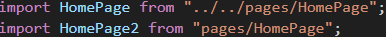
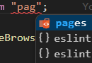

# Importing Components

Use shortcuts to simplify the import path to the following folders.

> | Shortcut      | Folder          |
> | :------------ | :-------------- |
> | `"@/"`        | `src/`          |
> | `"app/"`      | `src/app/`      |
> | `"features/"` | `src/features/` |
> | `"pages/"`    | `src/pages/`    |
> | `"shared/"`   | `src/shared/`   |

Compare the length of the relative path vs. the shortcut path. The relative path is much longer.



> **TIP!** Visual Studio Code will show suggest text completion for shortcuts as well!
>
> 

## Table of Contents

- [Description](#description)
- [Contributing](#contributing)

## Description

The shortcuts are added in `tsconfig.json` files by using the [`paths`🔗‍️](https://www.typescriptlang.org/tsconfig/#paths) property. In this project, it defined in `tsconfig.app.json`.

```json
{
	"compilerOptions": {
		"paths": {
			"@/*": ["./src/*"],
			"app/*": ["./src/app/*"],
			"features/*": ["./src/features/*"],
			"pages/*": ["./src/pages/*"],
			"shared/*": ["./src/shared/*"]
		}
	}
}
```

Starting the app now while using the shortcut paths would cause the app to crash. This is because the app use **Vite**, and **Vite** does not _recognise_ the paths yet.

So the `resolve` property have to be added to `vite.config.ts`.

```ts
export default defineConfig({
	resolve: { tsconfigPaths: true },
});
```

## Contributing

If another shortcut path is needed, here's how to do it:

1.  Open the `tsconfig.app.json` file.
1.  Inside `"compilerOptions"`, go to `"paths"`.
1.  Add a row inside the `"paths"` property.
	
	For example: `"alias/*": ["path/to/folder/*"]`
	
	> **NOTE!**
	> Before [TypeScript 4.1], the `baseUrl` property was required to use the `paths` property.
	>
	> In [TypeScript 7], `baseUrl` is deprecated.
	>
	> To view the project's TypeScript version, see [`package.json`](../../package.json).

1. Each row consists of an `alias`, which is the shortcut; and a `path`, which is the path to the actual folder.
	1. Always end `alias` and `path` with an `*` asterisk.
	1. A `path` always starts from the same folder as the `tsconfig.json` file.

1. Now test the shortcut by opening a `.ts` or `.tsx` file and import something using the `alias`.

	For example, if the shortcut is `"auth/*": ["./src/features/auth/*"]` then write it out...
	
	```ts
	import LoginForm from "auth/components/LoginForm";
	``` 

[TypeScript 4.1]: https://www.typescriptlang.org/docs/handbook/release-notes/typescript-4-1.html#paths-without-baseurl
[TypeScript 7]: https://typescriptdocs.com/release-notes/TypeScript%207.0#removed-options
